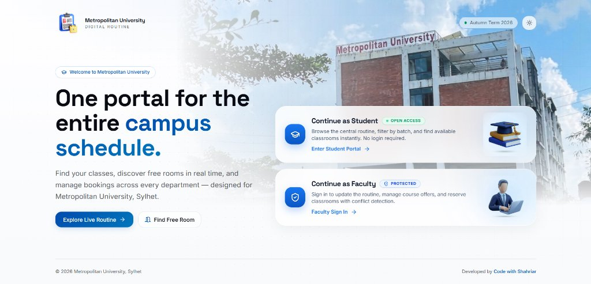
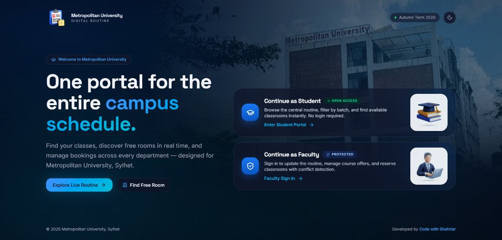
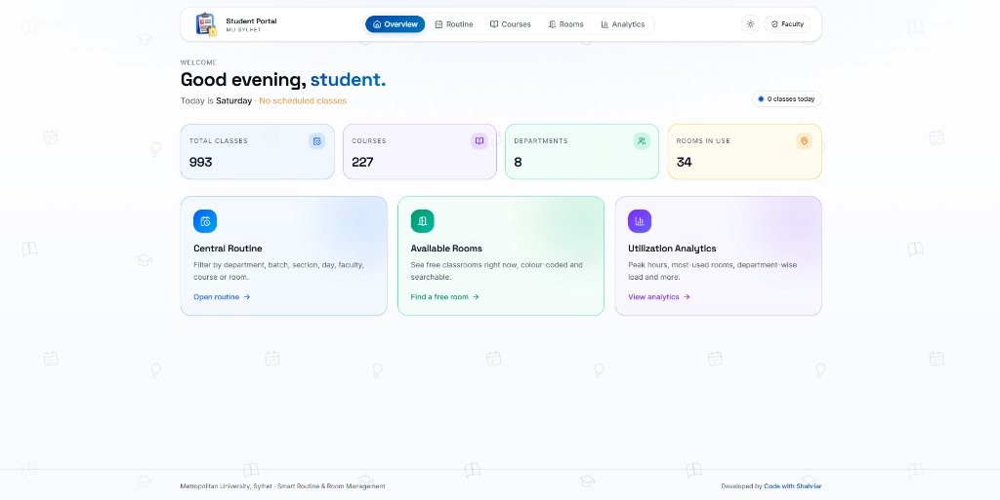

<div align="center">


# MU Smart Campus

**Digital Routine, Live Room Availability & Campus Analytics Portal for Metropolitan University, Sylhet**

[](https://react.dev/)
[](https://www.typescriptlang.org/)
[](https://tanstack.com/start)
[](https://tailwindcss.com/)
[](https://vite.dev/)

</div>

---

## Overview

**MU Smart Campus** is a modern, responsive web portal built for students and faculty of **Metropolitan University, Sylhet**. It centralizes the **Autumn Term 2026** academic schedule across all 8 departments (`CSE`, `EEE`, `SWE`, `BBA`, `ENG`, `ECO`, `LAW`, `DSC`), provides real-time classroom availability with floor and room-type filtering, and offers utilization analytics alongside faculty-side schedule and booking management.

---

## Portal Preview

### Landing Portal
Clean entry experience with a blended Metropolitan University campus backdrop, frosted glass role cards, 3D illustrations, light/dark theme toggle, and smooth right-to-left View Transitions.

**Light Mode**



**Dark Mode**



### Student Dashboard
Real-time overview of total scheduled classes, courses, departments, active rooms, live running classes for the current slot, and instant navigation to Routine, Rooms, Courses, and Analytics.



---

## Key Features

### Student Portal (Open Access)
- **Live Overview Dashboard**: Displays today's schedule context, current time slot, active classes happening right now, and campus-wide KPIs.
- **Central Routine Explorer**:
  - Instant search across courses, faculty, rooms, and batches.
  - Department & day quick-filter pills with live class counts.
  - Multi-filter bar by **Department**, **Batch**, **Day**, **Time Slot**, **Faculty**, **Course**, and **Room**.
  - Clean desktop table view and responsive mobile card view with live slot indicators.
- **Real-Time Room Availability**:
  - Live **Available**, **Occupied**, and **Booked** status for every room by day and time slot.
  - Filter by **Room Type** (`Classroom`, `Lab`, `Extension`) and **Floor** (`Ground (GL)`, `Floor 1 (1xx)` – `Floor 5 (5xx)`, `Extension (E)`).
  - Tap any room card to view its full-day slot-by-slot schedule modal.
- **Course Offers**: Browse batch-, section-, and semester-wise course offerings.
- **Utilization Analytics**: Interactive Recharts visualizations for day-wise class load, busiest time slots, department-wise distribution, and most/least used rooms.

### Faculty Portal (Protected)
- **Faculty Dashboard**: Quick summary of campus classes, reservations, and management shortcuts.
- **Routine Management**: Add, edit, and manage class routine entries.
- **Course Offer Management**: Create and update batch/semester course lists.
- **Conflict-Aware Room Booking**: Reserve available classrooms for specific days and time slots with automatic conflict checks.

### UX & Performance
- **Smooth Transitions**: Preloaded routes with `View Transitions API` right-to-left slide from the landing page and blur-rise tab transitions inside the Student Portal.
- **Mobile-First Responsiveness**: Adaptive layouts, 2-column mobile filter grids, bottom-friendly navigation, and responsive modals.
- **Light & Dark Mode**: Full theme support with light mode as the default for first-time visitors.

---

## Tech Stack

| Layer | Technology |
| :--- | :--- |
| **Framework** | React 19, TypeScript 5.8, TanStack Start & TanStack Router |
| **State & Data** | Zustand, TanStack Query, PapaParse (CSV parsing) |
| **Styling & UI** | Tailwind CSS v4, Radix UI primitives, Lucide React icons |
| **Charts** | Recharts |
| **Build & Server** | Vite 8, Nitro |
| **Code Quality** | ESLint 9, Prettier 3 |

---

## Project Structure

```text
MU Smart Campus/
├── docs/
│   └── screenshots/          # Portal preview images used in documentation
├── public/
│   ├── brand-logo.png        # Portal brand icon
│   └── data/
│       ├── routine.csv       # Central Autumn 2026 class schedule
│       ├── rooms.csv         # Campus room inventory & capacities
│       └── course_offers.csv # Department/batch course offerings
└── src/
    ├── components/
    │   ├── analytics/        # Utilization charts and KPI views
    │   ├── course/           # Course offer explorer & editor
    │   ├── layout/           # StudentShell & FacultyShell navigation layouts
    │   ├── routine/          # RoutineExplorer table, cards, and filters
    │   └── ui/               # Reusable UI primitives, motion & doodle bg
    ├── lib/
    │   └── data/             # Store, CSV parsers, types, and utilities
    └── routes/
        ├── index.tsx         # Landing portal
        ├── student/          # Student overview, routine, courses, rooms, analytics
        └── faculty/          # Faculty login, dashboard, manage, course-offer, book
```

---

## Getting Started

### Prerequisites

- **Node.js** `18+` (recommended `20+`)
- **npm**

### Installation & Local Development

1. **Clone the repository**

   ```bash
   git clone https://github.com/CodewithShahriar/MU-Smart-Campus.git
   cd MU-Smart-Campus
   ```

2. **Install dependencies**

   ```bash
   npm install
   ```

3. **Start the development server**

   ```bash
   npm run dev
   ```

4. **Open in your browser**

   ```text
   http://localhost:5173
   ```

---

## Available Scripts

| Command | Description |
| :--- | :--- |
| `npm run dev` | Start the Vite development server |
| `npm run build` | Build client and SSR production bundles |
| `npm run preview` | Preview the production build locally |
| `npm run lint` | Run ESLint across the codebase |
| `npm run format` | Format files with Prettier |

---

## Data Sources & Demo Notes

- Schedule, room inventory, and course offerings are loaded from `public/data/routine.csv`, `public/data/rooms.csv`, and `public/data/course_offers.csv`.
- Faculty edits and room reservations are persisted locally in the browser (`localStorage`) for demonstration and development.
- Demo faculty sign-in credentials:
  - **Email**: `admin@gmail.com`
  - **Password**: `123456`

---

## License

Intended for academic, internal campus, and demonstration use at Metropolitan University, Sylhet.

<div align="center">
  <sub>Developed by <a href="https://github.com/CodewithShahriar">Code with Shahriar</a></sub>
</div>
